# 知源 · 企业 AI 知识库

> 上传企业资料 → 自动构建知识库 → 员工用自然语言提问 → AI 基于原文作答，**每一条结论都能点开看到出自哪份文件、哪一页、哪一段**。

一个可本地运行的 RAG（Retrieval-Augmented Generation）企业知识库，覆盖「资料入库 → 检索 → 生成 → 引用溯源 → 检索过程可视化 → 效果评测」的完整闭环。

| 版本 | 内容 |
|---|---|
| v0.1 | RAG MVP：多格式解析、按章节切片、向量检索、拒答闸门、流式问答、引用校验、检索详情 |
| v0.2 | 检索质量 + 评测：混合检索（向量 + BM25，RRF 融合）、Rerank 重排、多轮追问改写、RAG 评测体系与评测页面。评测通过率 81% → 100%（[详见第 9 节](#9-rag-评测)） |
| **v0.3** | **体验 + 产品闭环**：用评测数据做模型选型，首字延迟 **2.4 s → 0.6 s**；用户反馈（点赞 / 点踩 + 原因）→ 差评一键转评测题；知识洞察页自动生成**知识缺口报告**（该补什么文档、找哪个部门） |

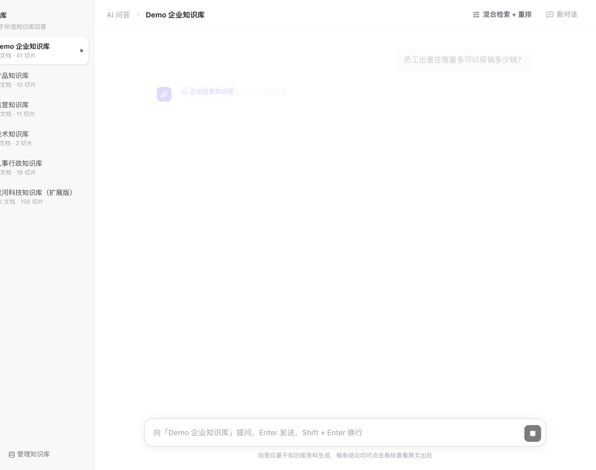

<table>
<tr>
<td width="50%">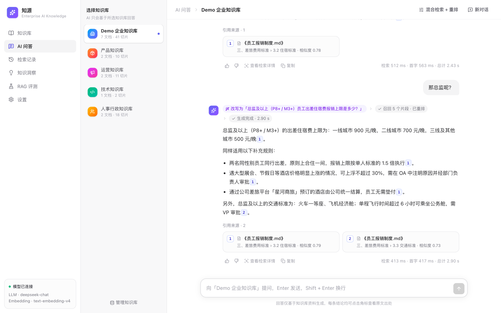<br><sub>AI 问答：追问自动改写，每条结论带可点击的引用</sub></td>
<td width="50%">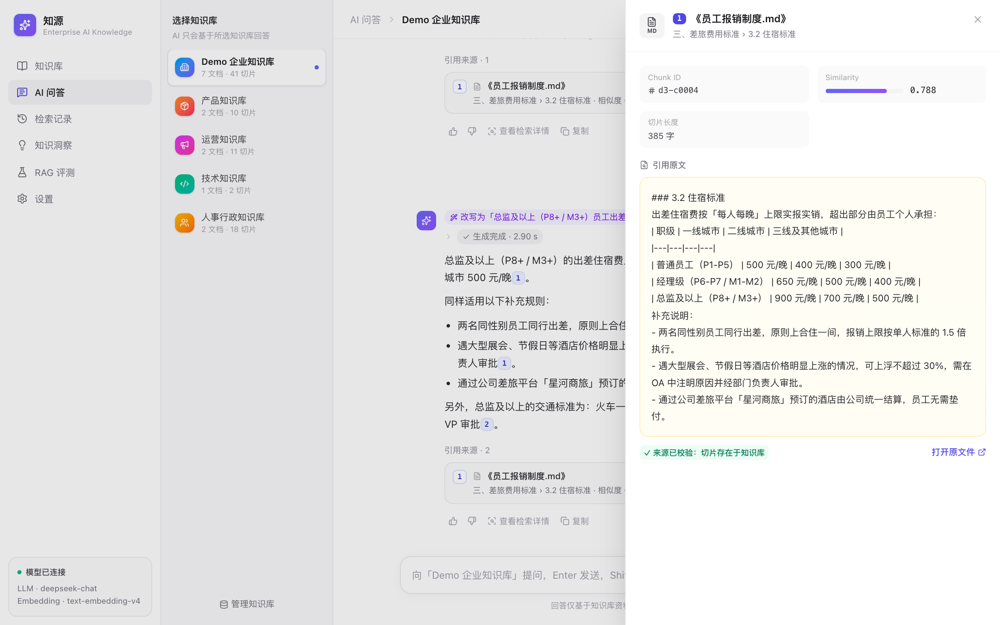<br><sub>点击引用查看原文，并校验来源真实存在</sub></td>
</tr>
<tr>
<td>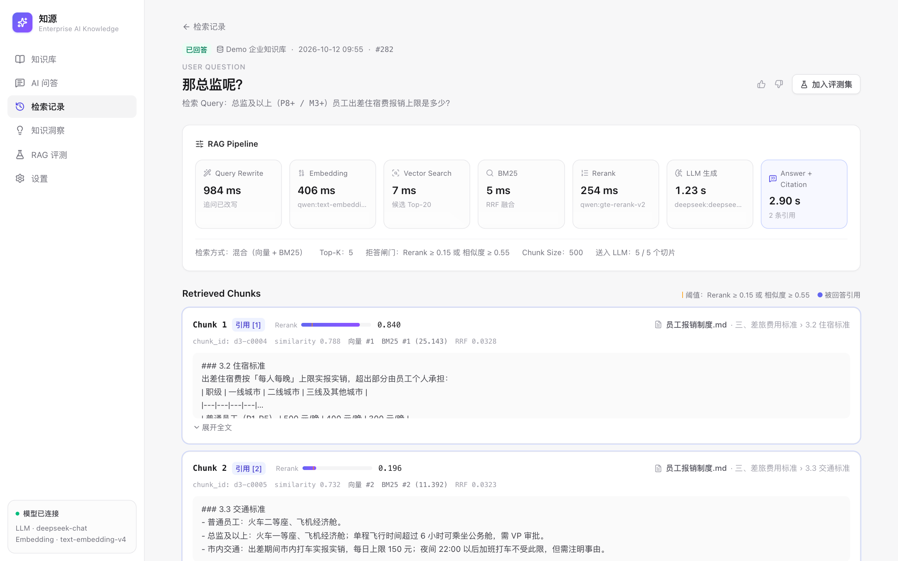<br><sub>检索详情：7 个阶段耗时、向量 / BM25 / 重排分数</sub></td>
<td>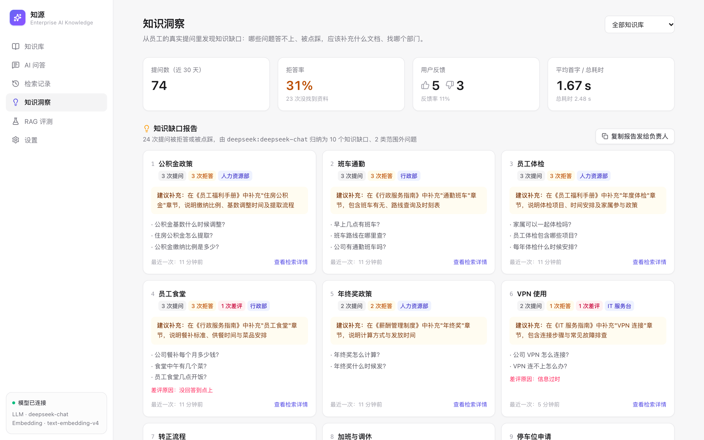<br><sub>知识洞察：拒答 / 差评问题自动归纳为知识缺口</sub></td>
</tr>
<tr>
<td>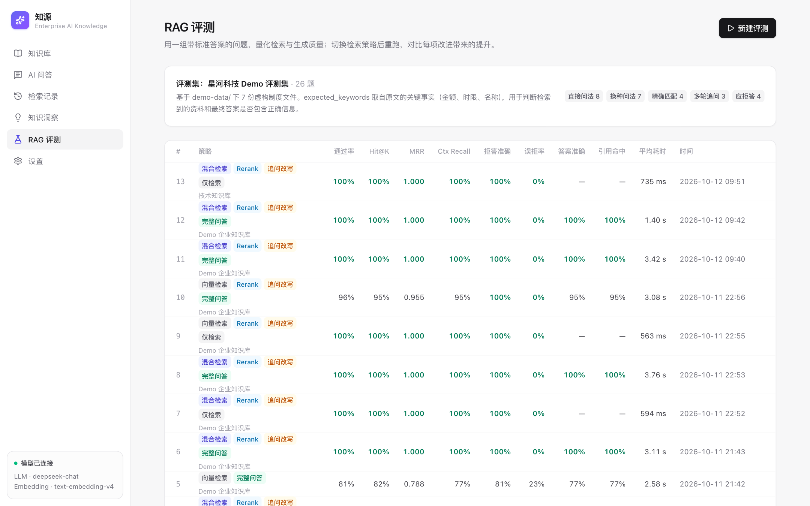<br><sub>RAG 评测：多种检索策略、多个模型横向对比</sub></td>
<td>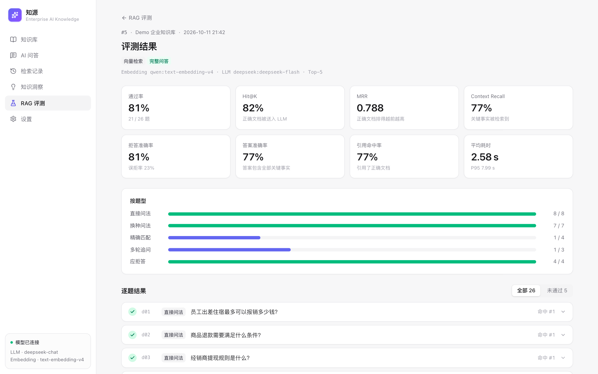<br><sub>评测详情：按题型定位短板，逐题查看失败原因</sub></td>
</tr>
<tr>
<td>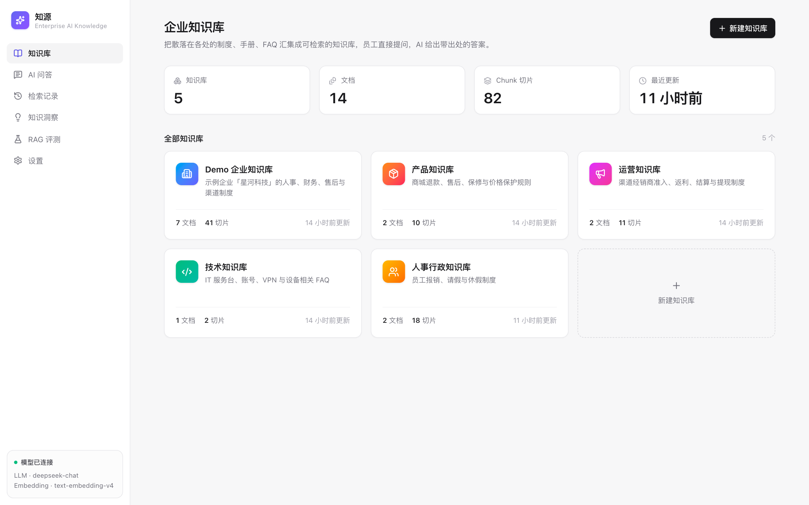<br><sub>知识库首页</sub></td>
<td>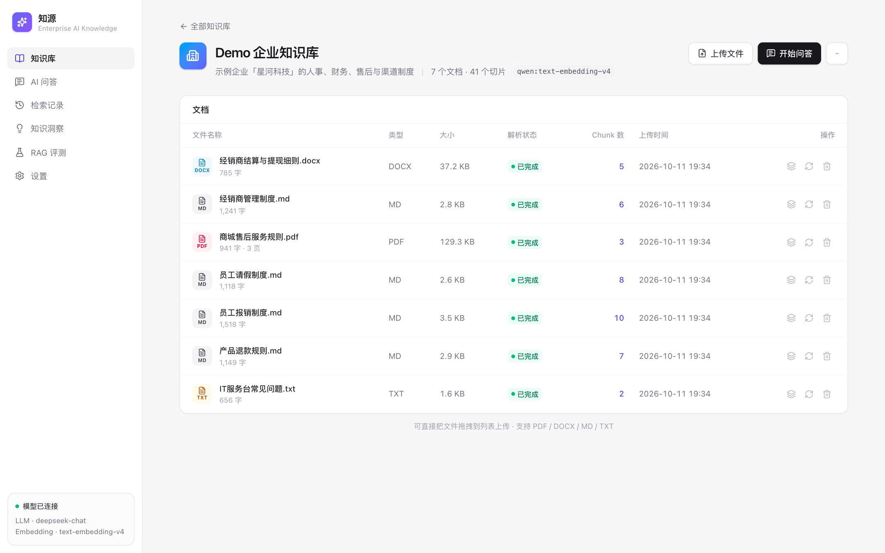<br><sub>知识库详情：上传、解析状态、切片</sub></td>
</tr>
</table>

> 截图由 `backend/scripts/screenshots.py` 自动生成，界面改动后重新运行即可更新。

| 页面 | 能做什么 |
|---|---|
| **知识库首页** | 知识库 / 文档 / 切片数量统计，按部门管理知识库，一键导入 Demo 数据 |
| **知识库详情** | 拖拽上传 PDF / DOCX / Markdown / TXT，实时看到「解析 → 向量化 → 完成」状态，查看每个文档的切片，重新解析，删除 |
| **AI 问答** | ChatGPT 式流式对话，左侧选知识库；回答中的 `[1]` 角标和下方来源卡片都可点开查看原文，PDF 可直接跳到引用页；每条回答可点赞 / 点踩并选择原因 |
| **检索详情** | 一次问答的完整 RAG 轨迹：追问改写 → Embedding → 向量检索 → BM25 → 重排 → 生成各阶段耗时；每个切片的相似度、向量 / BM25 排名、RRF 分数、重排分数、是否被引用；实际发给大模型的 Prompt |
| **知识洞察** | 提问量、拒答率、好评 / 差评、耗时、每日趋势；文档引用排行（发现从未被引用的文档）；热门问题；**知识缺口报告**：把拒答和差评的问题按主题归类，给出建议补充的文档和负责部门，可一键复制发给负责人 |
| **RAG 评测** | 26 道带标准答案的评测题，一键评测 Hit@K、MRR、Context Recall、拒答准确率、答案准确率、引用命中率；多组检索策略横向对比，逐题查看失败原因 |
| **设置** | 当前 LLM / Embedding / Rerank / RAG 参数，一键连通性测试 |

---

## 1. 产品背景

企业的制度和业务知识散落在 PDF、Word、Wiki、群聊文件里：报销标准在财务的 PDF 里，退款规则在运营的 Markdown 里，经销商提现细则在一份 Word 附件里。员工遇到问题时，要么自己翻文件，要么去问「知道的人」。

大模型擅长理解问题和组织语言，但**它不知道你公司的规则**。直接问 ChatGPT「我们公司出差住宿能报多少」，它只会给出一个看似合理、实则编造的答案。这在企业场景里是不可接受的。

## 2. 用户痛点

| 角色 | 痛点 |
|---|---|
| 一线员工 | 找不到：不知道规则写在哪份文件；找到了也要从几十页里定位到那一条 |
| 制度归口部门（财务 / HR / 渠道） | 被重复提问：同样的问题每周回答几十遍 |
| 管理者 | 不敢用：通用 AI 会「一本正经地胡说八道」，答错一个金额或时限就可能造成损失 |
| AI 产品 / 技术团队 | 不可调试：答案错了，不知道是没检索到、检索错了，还是模型自己编的 |

## 3. 产品方案

**核心原则：AI 只基于企业知识库作答，答不了就明确说不知道，说出的每一句都可溯源。**

| 痛点 | 方案 | 实现 |
|---|---|---|
| 找不到 | 自然语言提问，语义检索 | Embedding + 向量检索，问法和原文用词不同也能召回 |
| 定位难 | 引用精确到文件 / 页码 / 章节 | 切片保留 `document_id / page / section / chunk_id`，点击即看原文 |
| 不敢用 | 防编造三道闸 | ① 相似度阈值：无相关资料时**不调用大模型**，直接回答「没有找到」<br>② Prompt 约束：只能依据给定资料，必须标注 `[编号]`<br>③ 引用校验：后端校验每个编号，删除不存在的引用，并对齐到真实切片 |
| 问法五花八门 | 混合检索 + 追问改写 | 向量检索理解语义，BM25 精确匹配编号 / 电话 / 专有名词，Reranker 精排；「那总监呢？」先结合上下文改写成完整问题 |
| 不可调试 | 检索过程可视化 | 每次问答落库：召回切片、各路排名与分数、阈值、是否被引用、完整 Prompt、各阶段耗时 |
| 不知道好不好 | 量化评测 | 评测集 + 自动评分，每次改动检索策略或换模型都能用数据说明效果，而不是凭感觉 |
| 答不上来的问题没人管 | 知识缺口闭环 | 用户点踩 + 拒答记录 → 自动归纳成「该补什么文档、找哪个部门」的报告 → 内容负责人补文档；差评一键转成评测题，防止同类问题复发 |
| 多部门 | 按部门划分知识库 | 产品 / 技术 / 运营 / 人事行政知识库；数据模型已预留部门与权限字段 |

**核心用户流程**

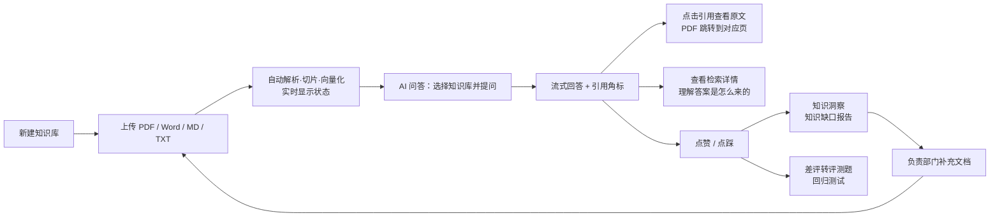

## 4. 系统架构

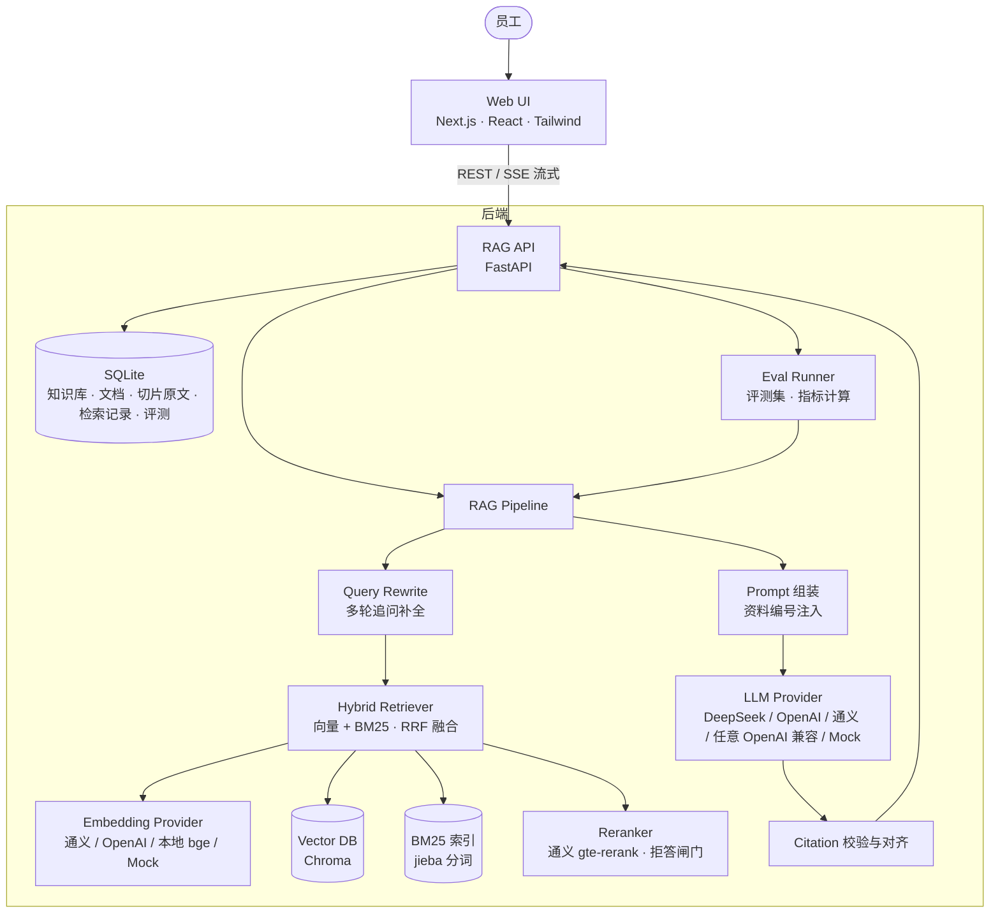

**问答链路**

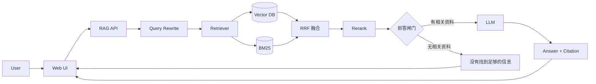

**入库链路**

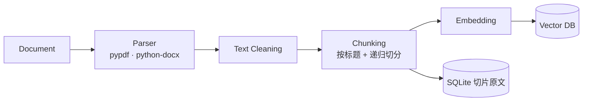

### 目录结构

```
enterprise-kb/
├── start.sh                    一键启动前后端
├── demo-data/                  7 份虚构企业制度（MD / PDF / DOCX / TXT）
├── backend/
│   ├── app/
│   │   ├── main.py             FastAPI 入口
│   │   ├── config.py           全部配置来自 .env；Provider 预设
│   │   ├── db.py               SQLAlchemy 模型：KnowledgeBase / Document / Chunk / QueryLog
│   │   ├── providers/          ★ 模型抽象层
│   │   │   ├── llm.py          LLMProvider 接口；OpenAI 兼容实现；Mock 抽取式回答器
│   │   │   ├── embedding.py    EmbeddingProvider 接口；远程 / 本地 fastembed / Mock
│   │   │   └── rerank.py       Reranker 接口；通义 gte-rerank
│   │   ├── rag/                ★ RAG Pipeline，每个环节一个文件
│   │   │   ├── parsers.py      Parser（可注册新格式）
│   │   │   ├── cleaning.py     Text Cleaning（含 PDF 断行修复）
│   │   │   ├── chunking.py     Chunking（LangChain text-splitters）
│   │   │   ├── ingest.py       入库编排：解析 → 清洗 → 切片 → 向量化 → 写库
│   │   │   ├── vectorstore.py  Vector DB 适配（Chroma），换库只改这一个文件
│   │   │   ├── bm25.py         BM25 关键词索引（jieba 分词，按知识库缓存，文档变更自动重建）
│   │   │   ├── retriever.py    混合检索：向量 + BM25 → RRF 融合 → Rerank → 拒答闸门
│   │   │   ├── query_rewrite.py 多轮追问改写
│   │   │   ├── prompts.py      System Prompt 与资料注入格式
│   │   │   ├── citations.py    引用规范化、越界过滤、重编号
│   │   │   └── pipeline.py     问答编排，产出 SSE 事件流并记录检索轨迹
│   │   ├── eval/               ★ RAG 评测
│   │   │   ├── datasets/demo.json  26 道评测题（5 类题型）
│   │   │   └── runner.py       逐题运行、自动评分、指标汇总
│   │   └── api/                REST 接口（含 insights.py：知识洞察与缺口报告）
│   ├── scripts/
│   │   ├── seed_demo.py        初始化产品 / 运营 / 技术 / 人事行政四个知识库
│   │   ├── run_eval.py         命令行评测，输出多策略 / 多模型对比表
│   │   ├── simulate_usage.py   模拟一批员工提问和反馈，让洞察页有数据
│   │   ├── screenshots.py      自动生成 README 截图和动图（Playwright + 本机 Chrome）
│   │   └── make_demo_files.py  生成 Demo PDF 和 DOCX
│   └── tests/test_rag.py       单元测试 + 离线端到端测试
└── frontend/src/
    ├── app/                    页面：/  /kb/[id]  /chat  /retrievals  /retrievals/[id]  /insights  /evals  /evals/[id]  /settings
    ├── components/             AnswerMarkdown（引用角标）、SourceDrawer（原文查看）、UI 组件
    └── lib/api.ts              类型定义、API 封装、SSE 流式解析
```

## 5. RAG 工作原理

### 5.1 入库（Ingestion）

| 环节 | 做法 | 为什么 |
|---|---|---|
| **Parser** | PDF 用 pypdf **逐页**解析；Word 把「标题 1/2/3」样式转成 Markdown `#` 标题，表格转成行文本，编号列表补回序号；TXT 自动识别 UTF-8 / GBK | 保留页码和章节结构，是精确引用的前提 |
| **Cleaning** | 去控制字符、合并多余空白；PDF 专门做**断行修复**：上一行接近满行宽且没有句末标点时，与下一行拼接，标题和列表不拼接 | PDF 抽取的文本每行都有硬换行，不修复会把一句话切成两半 |
| **Chunking** | ① 有标题的文档先按 `# / ## / ###` 切成章节，**切片不跨章节**，并记录章节路径（如 `三、差旅费用标准 > 3.2 住宿标准`）<br>② 每个章节 / PDF 的每一页再用递归切分器切到 500 字符以内（overlap 80，约 16%），优先在段落、句号处断开<br>③ PDF 切片**不跨页**，页码准确 | 语义完整的切片召回更准；500 中文字符约 500–700 tokens，落在推荐区间 |
| **Embedding** | 送去向量化的文本 = `《文件名》 章节路径` + 切片正文（Contextual Chunk Header） | 「1.5 倍执行」这种短句本身语义很弱，带上「员工报销制度 › 住宿标准」后才能被正确召回 |
| **Vector DB** | Chroma 本地持久化，每个知识库一个 collection，余弦距离；切片原文同时存 SQLite | 向量库只负责检索；切片浏览、引用校验、以后的 BM25 / 权限过滤都不依赖向量库 |

每个切片的 metadata：`document_id · document_name · page · section · chunk_id · chunk_index · kb_id`。

### 5.2 问答（Query）

```
用户问题
  → Query Rewrite：先用规则判断是否像追问（很短 / 以「那」「这个」开头 / 含指代词），是才让 LLM 改写
     （「那总监呢？」→「总监出差住宿标准是多少？」）；完整的问题直接检索，省掉一次 LLM 调用
  → 两路召回，各取 20 个候选
      ├─ 向量检索：问题向量 vs 切片向量，余弦相似度（擅长语义：「酒店能报多少」≈「住宿标准」）
      └─ BM25：jieba 分词后做关键词匹配（擅长字面：XH-FIN-018、400-800-1234、分机 8021）
  → RRF 融合：score = Σ 1 / (60 + rank)，只看排名，不需要对齐两种分数的量纲
  → Rerank：通义 gte-rerank 对候选做「问题 + 切片」交叉打分，重新排序，取 Top-5
  → 拒答闸门：重排分数 ≥ 0.15 或 余弦相似度 ≥ 0.55 的切片才送入 LLM
      └─ 全部不达标 → 直接回答「当前知识库中没有找到足够的信息」，不调用 LLM
  → 组装 Prompt：System Prompt + 资料按 [1]..[n] 编号注入 + 最近 3 轮对话 + 用户问题
  → LLM 流式生成（SSE 推送到前端）
  → Citation 后处理：统一【1】/[1,2] 等格式 → 删除越界编号 → 按出现顺序重编号 → 对齐到真实切片
  → 返回 Answer + Citations，整条轨迹写入检索记录
```

每一步都可以在 `.env` 里配置，也可以在问答页右上角的「检索策略」菜单里按请求临时切换，方便现场对比。

**闸门阈值是用评测数据标定的**，不是拍脑袋：

| 信号 | 能回答的题（正确切片） | 应拒答的题（最高分） | 结论 |
|---|---|---|---|
| 余弦相似度（通义 text-embedding-v4） | 0.40 – 0.78 | 0.41 | 有重叠：仅靠相似度，「分机 8021」「400 电话」这类精确匹配题会被误拒 |
| 重排分数（gte-rerank-v2） | 0.17 – 0.92 | 0.14 | 能分开，但口语化问法（「请客户吃饭每人能花多少」）分数偏低，余量很小 |
| **两者结合** | 重排 ≥ 0.15 **或** 相似度 ≥ 0.55 | — | 评测集上无误拒、无漏拒 |

v0.1 只有向量检索时，阈值固定为相似度 0.45（见 `providers/embedding.py`，按模型分别配置），也可用 `MIN_SCORE` 覆盖。

**System Prompt 要点**（完整内容见 `rag/prompts.py`，设置页和检索详情页里也能看到）：只依据参考资料；资料里没有就回答「当前知识库中没有找到足够的信息。」；部分能答就说明哪部分没提到；每条关键信息标注 `[编号]`，禁止编造编号；数字、金额、时限必须与原文一致。

## 6. 技术选型

| 层 | 选型 | 理由 |
|---|---|---|
| 前端 | **Next.js 16**（App Router）+ React 19 + Tailwind CSS 4 + SWR + lucide-react + react-markdown | 主流 React 技术栈；SWR 负责轮询解析状态；react-markdown 渲染回答并把 `[n]` 替换成可点击角标 |
| 后端 | **FastAPI** + SQLAlchemy 2 + SQLite | Python 是 AI 生态主场；SQLite 零运维，接口层不变即可换 PostgreSQL |
| 文档解析 | pypdf · python-docx | 成熟稳定，能拿到页码和样式信息 |
| 切片 | **LangChain text-splitters**（MarkdownHeaderTextSplitter + RecursiveCharacterTextSplitter） | 只引入切分这一个成熟组件。Pipeline 编排自己写，每个环节可见、可调试，不被框架黑盒挡住 |
| 向量库 | **Chroma**（本地持久化） | 无需 Docker，`pip install` 即可用；适配层已隔离，可换 Qdrant / Milvus / pgvector |
| 关键词检索 | **rank-bm25 + jieba** | 切片原文本就在 SQLite，内存中建 BM25 索引即可；规模变大可换 Elasticsearch，接口不变 |
| 重排 | **通义 gte-rerank-v2** | 中文效果好，约 300 ms；`Reranker` 接口可换 Cohere / Jina / 本地 bge-reranker |
| Embedding | 通义 `text-embedding-v4`（默认）/ OpenAI / **本地 bge-small-zh-v1.5（fastembed，CPU 运行）** / Mock | 中文效果好；没有 Key 也能用本地模型做真实的语义检索 |
| LLM | DeepSeek `deepseek-chat`（默认）/ OpenAI / 通义千问 / 任意 OpenAI 兼容接口 / Mock | 统一 `LLMProvider` 接口，`.env` 切换；默认模型由评测数据选出（见第 9 节「用评测做模型选型」） |
| 流式 | SSE（`retrieval → token… → done` 事件流） | 先展示「召回了几个片段」再逐字输出，演示时用户能看到 RAG 的每一步 |

**为什么没有直接用 LlamaIndex / LangChain 的完整 RAG 链？** 作为作品集，「检索详情」页需要拿到每一步的中间结果（相似度、阈值判断、Prompt、引用对齐），自己编排 Pipeline 更透明，也更方便以后插入 Rerank / Hybrid Search。成熟的底层组件（解析、切分、向量库、模型 SDK）都用现成的开源库。

## 7. 如何启动

**环境要求**：Python ≥ 3.11，Node.js ≥ 20（已在 Python 3.13 / Node 22 / macOS arm64 上验证）

### 一键启动

```bash
./start.sh
```

首次运行会自动创建虚拟环境、安装依赖、复制 `.env`。启动后打开 **http://localhost:3100**，后端 API 文档在 http://localhost:8100/docs。

### 分别启动

```bash
# 后端
cd backend
python3 -m venv .venv && .venv/bin/pip install -r requirements.txt
cp .env.example .env            # 按需填写 Key，不填也能运行
.venv/bin/uvicorn app.main:app --port 8100

# 前端（新终端）
cd frontend
pnpm install                    # 或 npm install
cp .env.example .env.local
pnpm dev --port 3100
```

### 模型配置（`backend/.env`）

```ini
LLM_PROVIDER=deepseek          # openai / deepseek / qwen / openai_compatible / mock
LLM_API_KEY=sk-...
LLM_BASE_URL=                  # 用预设时可留空；openai_compatible 必填
LLM_MODEL=                     # 留空用预设默认模型

EMBEDDING_PROVIDER=qwen        # openai / qwen / openai_compatible / local / mock
EMBEDDING_API_KEY=sk-...       # 与 LLM 同厂商时可留空，自动复用

RERANK_PROVIDER=qwen           # qwen / none；EMBEDDING_PROVIDER=qwen 时自动复用其 Key
RETRIEVAL_MODE=hybrid          # hybrid（向量 + BM25）/ vector
QUERY_REWRITE=true             # 多轮追问改写（Mock LLM 下自动跳过）
```

| 场景 | 配置 |
|---|---|
| 完全离线、零 Key | `LLM_PROVIDER=mock`，`EMBEDDING_PROVIDER=local`（首次自动下载约 100MB 模型）。Mock LLM 会从检索结果中抽取原文片段作答，同样带引用 |
| 国内模型（推荐） | `LLM_PROVIDER=deepseek` + `EMBEDDING_PROVIDER=qwen` + `RERANK_PROVIDER=qwen` |
| 全部 OpenAI | `LLM_PROVIDER=openai` + `EMBEDDING_PROVIDER=openai` |
| 其他厂商（Kimi、智谱、本地 vLLM / Ollama…） | `LLM_PROVIDER=openai_compatible` + 填写 `LLM_BASE_URL` 和 `LLM_MODEL` |

> 更换 Embedding 模型后，已有知识库的向量维度和语义空间都不一致。系统会在问答时提示，在知识库详情页点「全部重新解析」即可重建。

## 8. Demo 数据

`demo-data/` 下是虚构公司「星河科技」的 7 份制度文件，覆盖全部支持的格式：

| 文件 | 格式 | 可以问 |
|---|---|---|
| 员工报销制度.md | Markdown（含表格） | 员工出差住宿最多可以报销多少钱？业务招待人均标准是多少？ |
| 员工请假制度.md | Markdown | 员工请婚假可以休几天？试用期员工可以请事假吗？ |
| 产品退款规则.md | Markdown | 商品退款需要满足什么条件？哪些商品不支持 7 天无理由？ |
| 经销商管理制度.md | Markdown | 经销商提现规则是什么？窜货会受到什么处罚？ |
| 经销商结算与提现细则.docx | Word（标题样式、表格、编号列表） | 经销商提现申请常见的驳回原因有哪些？ |
| 商城售后服务规则.pdf | PDF（3 页） | 维修完成后多久寄回？价格保护怎么申请？（引用带页码） |
| IT服务台常见问题.txt | TXT | 公司 VPN 怎么连接？密码多久要改一次？ |

导入方式（任选其一）：

- 首页点「**导入 Demo 数据**」：创建「Demo 企业知识库」并导入全部 7 份文件
- 新建一个空知识库，点「**使用示例资料**」：走与手动上传完全相同的上传流程
- 运行 `backend/.venv/bin/python backend/scripts/seed_demo.py`：创建产品 / 运营 / 技术 / 人事行政四个部门知识库

### 面试演示脚本（约 8 分钟）

1. **首页**：介绍场景，展示按部门划分的知识库和统计数据
2. **新建知识库 → 拖入文件**：看状态从「解析中」变成「向量化中」再到「已完成」，点开切片数，展示 PDF 切片带页码、Word 切片带章节路径
3. **AI 问答**：问「经销商提现需要满足什么条件？」，讲解进度条（召回 5 个片段 → 生成回答）、引用角标、来源卡片；点开引用，看到原文和「来源已校验」
4. **多轮追问**：接着问「那总监呢？」，进度条显示「改写为『总监出差住宿标准是多少？』」，答案正确
5. **问一个知识库外的问题**（「公司明年的上市计划是什么？」）：系统直接回答「没有找到足够的信息」，不调用大模型，也不编造
6. **检索详情**：讲解 7 个阶段的耗时、每个切片的向量 / BM25 / 重排分数与阈值、哪些被引用、实际发给模型的 Prompt，说明如何用这个页面定位「没检索到」还是「模型答错」
7. **知识洞察**：展示知识缺口报告，讲「从被动回答到主动发现知识盲区」：哪些问题答不上、该补什么文档、找哪个部门；再演示点踩一条回答 → 加入评测集
8. **RAG 评测**：打开评测页，展示纯向量 81% → 混合 + 重排 + 改写 100% 的对比；点进纯向量那次，按题型看出短板在「精确匹配」和「多轮追问」，再讲每项改进分别解决了哪类问题

## 9. RAG 评测

「这个知识库好不好用」不能只靠演示时挑几个问题。v0.2 加入了评测体系：用一组带标准答案的问题自动打分，每次调整检索策略都能用数据说明效果。

### 评测集

`backend/app/eval/datasets/demo.json`，26 题，覆盖 7 份 Demo 文件，按真实用户的提问方式分为 5 类：

| 题型 | 数量 | 例子 | 考察什么 |
|---|---|---|---|
| 直接问法 | 8 | 员工请婚假可以休几天？ | 基础检索能力 |
| 换种问法 | 7 | 去上海出差，普通员工一晚的酒店能报多少？ | 语义理解（原文是「一线城市住宿标准」） |
| 精确匹配 | 4 | 分机 8021 是哪个部门？ | 编号、电话、专有名词的字面匹配 |
| 多轮追问 | 3 | （上一轮问普通员工住宿）那总监呢？ | 结合上下文理解省略的问题 |
| 应拒答 | 4 | 员工食堂几点开饭？ | 知识库里没有时，不编造 |

每道题标注了「答案所在文档」和「关键事实」（金额、时限、名称），用于自动判分。

### 指标

| 指标 | 含义 |
|---|---|
| Hit@K | 答案所在文档出现在送入 LLM 的 Top-K 切片中的比例 |
| MRR | 答案所在文档第一次出现的位置的倒数，取平均（排得越前越高） |
| Context Recall | 关键事实出现在送入 LLM 的切片中的比例 |
| 拒答准确率 / 误拒率 | 该拒答的拒答了、不该拒答的作答了；能回答却被拒答的比例 |
| 答案准确率 | （完整问答模式）答案包含全部关键事实的比例 |
| 引用命中率 | （完整问答模式）引用中包含正确文档的比例 |

### 结果（Demo 企业知识库，通义 text-embedding-v4 + DeepSeek deepseek-flash）

**仅检索模式**（逐项叠加改进，约 15 秒跑完）：

| 策略 | 通过率 | Hit@5 | MRR | Context Recall | 拒答准确 | 误拒率 | 平均耗时 |
|---|---|---|---|---|---|---|---|
| 纯向量（v0.1） | 81% | 82% | 0.788 | 77% | 92% | 9% | 245 ms |
| + 追问改写 | 88% | 91% | 0.879 | 86% | 96% | 5% | 376 ms |
| + BM25 混合检索 | 92% | 91% | 0.909 | 91% | 96% | 5% | 436 ms |
| **+ Rerank（v0.2）** | **100%** | **100%** | **1.000** | **100%** | **100%** | **0%** | 572 ms |

**完整问答模式**（含 LLM 生成，评估最终答案）：

| 策略 | 通过率 | 答案准确率 | 引用命中率 | 误拒率 | 平均耗时 |
|---|---|---|---|---|---|
| 纯向量（v0.1） | 81% | 77% | 77% | 23% | 2.6 s |
| **混合 + 重排 + 改写（v0.2）** | **100%** | **100%** | **100%** | **0%** | 3.1 s |

**从失败案例看每项改进解决了什么**：

- **追问改写**：v0.1 直接拿「那总监呢？」去检索，召回的是不相关的切片 → 改写成「总监出差住宿标准是多少？」后命中
- **BM25**：「XH-FIN-018」「400-800-1234」这类编号对向量模型来说语义很弱，BM25 的字面匹配能直接排到第一
- **Rerank**：BM25 找到了「分机 8021」所在的切片，但它和问题的余弦相似度只有 0.40，被相似度闸门拦下；重排模型直接判断「问题 + 切片」是否相关，给出 0.35 分放行。同时把应拒答问题的分数压到 0.14 以下
- **代价**：每题多约 330 ms（重排约 300 ms，改写仅在有对话历史时触发，约 1–2 s）

> **诚实说明**：闸门阈值就是在这 26 道题上标定的，100% 有过拟合成分，代表「在已知问题上调到最好」。要得到可信的泛化结论，需要更大的、与调参集分开的测试集（见 Roadmap）。这套评测框架的价值在于：任何改动都能在 15 秒内看到量化影响，并定位到具体哪道题、哪个环节出了问题。

### 用评测做模型选型（v0.3）

v0.2 演示时首字常要等 5–8 秒。排查发现默认的 `deepseek-flash` 是**推理模型**：输出正文前会先在内部「思考」，资料越长思考越久，这段时间界面上什么都看不到。换成非推理模型能快很多，但质量会不会下降，用评测说话：

| 模型（混合 + 重排 + 改写） | 通过率 | 答案准确率 | 首字延迟（平均） | 首字延迟（P95） | 总耗时 |
|---|---|---|---|---|---|
| deepseek-flash（推理） | 100% | 100% | 2.4 s | 7.5 s | 3.7 s |
| **deepseek-chat（非推理）** | **100%** | **100%** | **0.6 s** | **0.7 s** | **1.6 s** |

在这套题上质量相同，首字快 4 倍、最慢的情况快 10 倍，于是把默认模型换成 `deepseek-chat`。同时：

- **追问改写按需触发**：用规则先判断问题是否像追问，完整的问题不再多调一次 LLM（每轮省 0.5–2 秒）
- **改写可单独配快模型**：`REWRITE_MODEL`，改写只是补全问题，用不着推理模型
- **仍用推理模型时显示「模型思考中…」**：不让用户以为卡住了

> 评测题目偏「查事实」，推理模型的优势（多步推理、复杂计算）没有被考察到。如果业务里有大量需要综合推理的问题，应该补充这类评测题再做决定。

```bash
backend/.venv/bin/python backend/scripts/run_eval.py --mode full --configs hybrid+rerank --llm-model deepseek-chat
```

### 用户反馈评测集（v0.3）

在检索详情页点「加入评测集」，给一条差评补上标准答案（答案在哪份文档、关键事实是什么），它就进入「用户反馈评测集」。以后每次调整策略都可以跑一遍，确保**修好的问题不会再坏回去**（回归测试），评测集也会随真实使用不断变大。

### 怎么跑

- 页面：侧边栏「RAG 评测」→「新建评测」，选择知识库、模式和检索策略
- 命令行：`backend/.venv/bin/python backend/scripts/run_eval.py`（输出上面这样的对比表，结果同时出现在评测页）

```bash
backend/.venv/bin/python backend/scripts/run_eval.py --mode full --configs vector,hybrid+rerank
```

## 10. 知识洞察

RAG 系统上线后，最有价值的数据是**用户问了什么、哪些没答上来**。洞察页把检索记录变成可以行动的结论：

| 模块 | 做什么 | 实现 |
|---|---|---|
| 概览 | 提问量、拒答率、好评 / 差评、首字与总耗时、近 14 天趋势 | 聚合检索记录 |
| 文档引用排行 | 每份文档被引用多少次；「从未引用」的文档可能已过时或不被需要 | 统计回答中的引用 |
| 热门问题 | 相似问法合并后，大家最常问什么 | Embedding 聚类 |
| **知识缺口报告** | 拒答和差评的问题按主题归类，每类给出建议补充的文档 / 章节和负责部门；天气、未公开战略这类范围外问题单独列出（拒答本身就是对的）；可一键复制 Markdown 发给负责人 | LLM 归类 + 命名 |

**为什么归类交给 LLM 而不是只用 Embedding 聚类**：实测通义 v4 下，同一主题的问题相似度最低只有 0.49（「公积金怎么提取」vs「公积金基数调整」），而不同主题最高有 0.60（「公积金基数什么时候调整」vs「年终奖什么时候发」）。短问题的向量被「什么时候 / 多少钱」这类句式主导，任何阈值都分不干净。LLM 按语义主题归类后，21 个问题从「20 个碎片」变成「10 个清晰主题」。Embedding 聚类（阈值 0.62，宁可分细不错合）保留为热门问题和 Mock 模式下的兜底。

演示数据：`backend/scripts/simulate_usage.py` 会模拟 38 条员工提问（含食堂、班车、公积金、加班等知识库未覆盖的主题）和几条反馈。**这些是模拟数据**，用于展示洞察页的效果。

## 11. 测试结果

**自动化测试**：`cd backend && .venv/bin/pytest -q` → **18 passed**

- 引用：越界编号被删除，按出现顺序重编号，`[1][1]` 去重
- 清洗：PDF 断行修复不误伤标题和列表
- 7 个 Demo 文件全部解析成功；切片不超过 500 字符；PDF 页码 {1,2,3} 全部保留；MD / DOCX 带章节路径；Markdown 切片不跨章节
- BM25 分词保留编号和电话的各段，过滤停用词
- 混合检索：精确编号 `XH-FIN-018` 由 BM25 排到第一；纯向量模式不走 BM25
- 重排闸门：按重排分数排序；「重排达标 或 相似度达标」任一满足即放行
- 评测：单题判分（命中排名、Context Recall）与指标汇总（Hit Rate、MRR、拒答准确率、按题型统计）
- 追问改写规则：追问才改写，完整问题和无历史时跳过
- 反馈与洞察：点踩原因白名单过滤、差评筛选、差评转评测题（缺少标准答案时拒绝）、反馈评测集出现在评测集列表；洞察概览统计、缺口报告覆盖全部问题、时间带时区
- 离线端到端（Mock LLM + Mock Embedding）：上传 → 解析 → 问答 → 每条引用都指向真实存在的切片 → 检索记录落库 → SSE 事件顺序正确 → 删除文档后不再被召回

**浏览器端到端验收**（DeepSeek `deepseek-flash` + 通义 `text-embedding-v4` + `gte-rerank-v2`）：

- v0.1：新建知识库 → 上传 7 份资料（MD / PDF / DOCX / TXT）→ 全部解析成功（41 个切片）→ 问答 → 召回 → 流式生成带引用的回答 → 点击引用查看原文 → 检索详情；拖拽上传、重新解析、删除文档、删除知识库、连通性测试
- v0.3：换用 deepseek-chat 后单次问答首字 0.5 s、总计 1.7 s；点踩 → 选择原因 → 差评筛选 → 加入评测集 → 运行用户反馈评测集；知识洞察页生成 10 个知识缺口主题 + 2 类范围外问题
- v0.2：问答页切换检索策略；多轮追问「那总监呢？」被改写并答对（900 元/晚）；检索详情展示 7 个阶段与多路分数；评测页新建评测、查看进度、横向对比、逐题展开失败原因

| 问题 | Top-1 来源 | 结果 |
|---|---|---|
| 员工出差住宿最多可以报销多少钱？ | 员工报销制度.md › 3.2 住宿标准 | 按职级 × 城市列出全部标准，数字与原文一致 |
| 经销商提现规则是什么？ | 经销商管理制度.md › 四、经销商提现规则 | 综合 MD + DOCX 两份文件，5 条引用 |
| 维修多久能寄回？ | 商城售后服务规则.pdf **第 2 页** | 引用带页码 |
| XH-FIN-018 是哪份文件？ | 经销商结算与提现细则.docx（BM25 #1，重排 0.91） | 只有这一个切片通过闸门 |
| （追问）那总监呢？ | 改写为「总监出差住宿标准是多少？」 | 900 / 700 / 500 元/晚 |
| 公司明年的上市计划是什么？ | —（重排最高 0.006） | 拒答，未调用 LLM |

典型耗时（v0.3，deepseek-chat）：Embedding ~300 ms，向量检索 / BM25 各 < 5 ms，重排 ~300 ms，首字 ~0.6 s，总计 1.5–3 s。

## 12. 后续 Roadmap

架构上的扩展点：`Retriever` / `Reranker` / `LLMProvider` / `EmbeddingProvider` 接口、`vectorstore.py` 适配层、`parsers.PARSERS` 注册表、`Document.source`、`KnowledgeBase.department`、评测集目录。

| 阶段 | 方向 | 内容 | 状态 |
|---|---|---|---|
| **检索质量** | Hybrid Search | 向量 + BM25，RRF 融合 | ✅ v0.2 |
| | Reranker | 通义 gte-rerank 精排，并作为拒答闸门 | ✅ v0.2 |
| | Query Rewrite | 多轮追问改写成独立问题 | ✅ v0.2 |
| | Multi-Query / HyDE | 复杂问题拆成多个子查询；生成假设答案再检索 | |
| **评测** | RAG Evaluation | 评测集 + Hit@K / MRR / Context Recall / 拒答 / 答案准确率 + 策略对比页面 | ✅ v0.2 |
| | 扩大评测集 | 调参集与测试集分离；从真实检索记录中挑选问题补充 | |
| | LLM-as-Judge | 用大模型评估答案的忠实度和完整性（RAGAS 风格），补充关键词匹配 | |
| | 用户反馈 | 回答点赞 / 点踩 + 原因，差评一键转评测题 | ✅ v0.3 |
| **运营** | 知识洞察 | 知识缺口报告、文档引用排行、热门问题、趋势 | ✅ v0.3 |
| | 缺口工单 | 知识缺口一键生成工单 / 飞书消息推给负责部门，补完后自动重测相关问题 | |
| | 成本看板 | 每次问答的 token 用量与费用，按知识库 / 部门统计 | |
| **企业化** | 权限 | 用户 / 部门 / 角色，检索时把权限条件下推到向量库过滤 | |
| | 数据源同步 | 飞书 / Notion / Confluence / Google Drive 增量同步，网页抓取，文档版本管理 | |
| | 解析增强 | 扫描件 OCR、PPTX / Excel、表格结构化、图片理解 | |
| **智能化** | Agent | 知识库作为工具，结合业务系统查询（如「我的报销单到哪一步了」） | |
| | MCP | 把知识库检索封装成 MCP Server，供 Claude / Cursor 等客户端直接调用 | |
| | Knowledge Graph | 抽取制度之间的引用关系（如「细则 → 管理制度」），支持跨文档推理 | |
| **体验** | 响应速度 | 评测驱动的模型选型、按需追问改写、思考中提示 | ✅ v0.3 |
| | 原文高亮 | 点击引用时在原文中高亮具体句子 | |
| **工程化** | 部署 | Docker Compose、在线演示地址、PostgreSQL + pgvector / Qdrant、异步任务队列、对象存储 | |

## 已知限制

- 文档解析在 FastAPI 后台任务中执行，适合演示规模；大批量导入应改为任务队列
- 不支持扫描版 PDF（无文字层，需 OCR）
- 暂无登录和权限控制，所有知识库对所有人可见
- 评测集只有 26 题，且闸门阈值在同一批题上标定，指标偏乐观
- BM25 索引在内存中按知识库构建，适合万级以下切片
- 追问改写会额外调用一次 LLM（约 0.5 s），只在规则判断为追问时触发；规则可能漏判少数追问
- 知识洞察的演示数据由脚本模拟，不代表真实使用情况
