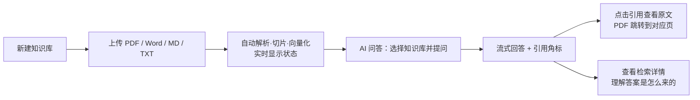
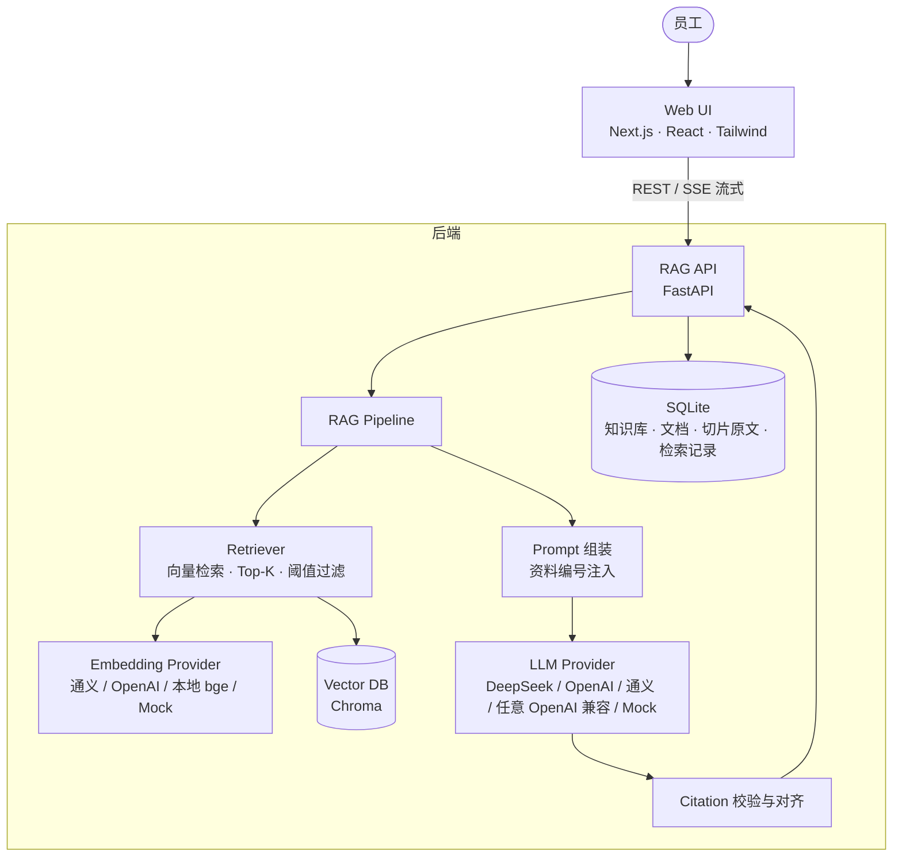
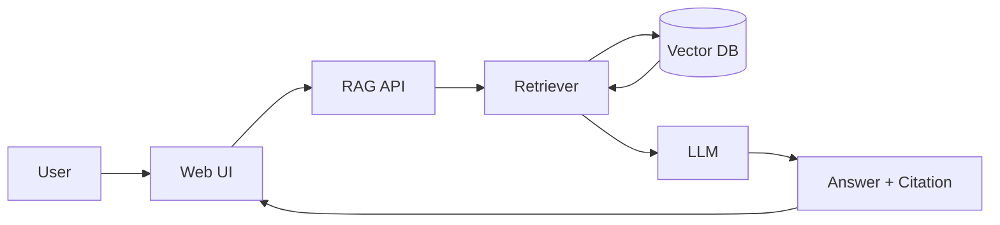
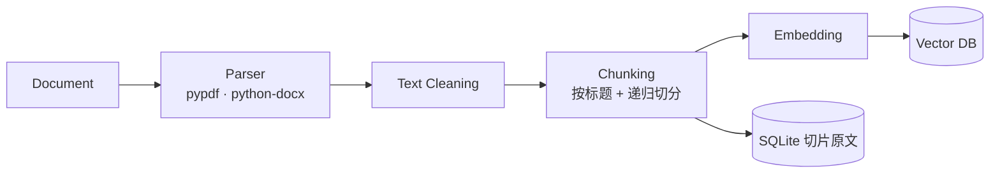

# 知源 · 企业 AI 知识库

> 上传企业资料 → 自动构建知识库 → 员工用自然语言提问 → AI 基于原文作答，**每一条结论都能点开看到出自哪份文件、哪一页、哪一段**。

一个可本地运行的 RAG（Retrieval-Augmented Generation）企业知识库 MVP，覆盖「资料入库 → 检索 → 生成 → 引用溯源 → 检索过程可视化」的完整闭环。

| 页面 | 能做什么 |
|---|---|
| **知识库首页** | 知识库 / 文档 / 切片数量统计，按部门管理知识库，一键导入 Demo 数据 |
| **知识库详情** | 拖拽上传 PDF / DOCX / Markdown / TXT，实时看到「解析 → 向量化 → 完成」状态，查看每个文档的切片，重新解析，删除 |
| **AI 问答** | ChatGPT 式流式对话，左侧选知识库；回答中的 `[1]` 角标和下方来源卡片都可点开查看原文，PDF 可直接跳到引用页 |
| **检索详情** | 一次问答的完整 RAG 轨迹：各阶段耗时、Top-K 切片的相似度与阈值、哪些被引用、实际发给大模型的 Prompt |
| **设置** | 当前 LLM / Embedding / RAG 参数，一键连通性测试 |

---

## 1. 产品背景

企业的制度和业务知识散落在 PDF、Word、Wiki、群聊文件里：报销标准在财务的 PDF 里，退款规则在运营的 Markdown 里，经销商提现细则在一份 Word 附件里。员工遇到问题时，要么自己翻文件，要么去问「知道的人」。

大模型擅长理解问题和组织语言，但**它不知道你公司的规则**。直接问 ChatGPT「我们公司出差住宿能报多少」，它只会给出一个看似合理、实则编造的答案。这在企业场景里是不可接受的。

## 2. 用户痛点

| 角色 | 痛点 |
|---|---|
| 一线员工 | 找不到：不知道规则写在哪份文件；找到了也要从几十页里定位到那一条 |
| 制度归口部门（财务 / HR / 渠道） | 被重复提问：同样的问题每周回答几十遍 |
| 管理者 | 不敢用：通用 AI 会「一本正经地胡说八道」，答错一个金额或时限就可能造成损失 |
| AI 产品 / 技术团队 | 不可调试：答案错了，不知道是没检索到、检索错了，还是模型自己编的 |

## 3. 产品方案

**核心原则：AI 只基于企业知识库作答，答不了就明确说不知道，说出的每一句都可溯源。**

| 痛点 | 方案 | 实现 |
|---|---|---|
| 找不到 | 自然语言提问，语义检索 | Embedding + 向量检索，问法和原文用词不同也能召回 |
| 定位难 | 引用精确到文件 / 页码 / 章节 | 切片保留 `document_id / page / section / chunk_id`，点击即看原文 |
| 不敢用 | 防编造三道闸 | ① 相似度阈值：无相关资料时**不调用大模型**，直接回答「没有找到」<br>② Prompt 约束：只能依据给定资料，必须标注 `[编号]`<br>③ 引用校验：后端校验每个编号，删除不存在的引用，并对齐到真实切片 |
| 不可调试 | 检索过程可视化 | 每次问答落库：召回切片、相似度、阈值、是否被引用、完整 Prompt、各阶段耗时 |
| 多部门 | 按部门划分知识库 | 产品 / 技术 / 运营 / 人事行政知识库；数据模型已预留部门与权限字段 |

**核心用户流程**



## 4. 系统架构



**问答链路**



**入库链路**



### 目录结构

```
enterprise-kb/
├── start.sh                    一键启动前后端
├── demo-data/                  7 份虚构企业制度（MD / PDF / DOCX / TXT）
├── backend/
│   ├── app/
│   │   ├── main.py             FastAPI 入口
│   │   ├── config.py           全部配置来自 .env；Provider 预设
│   │   ├── db.py               SQLAlchemy 模型：KnowledgeBase / Document / Chunk / QueryLog
│   │   ├── providers/          ★ 模型抽象层
│   │   │   ├── llm.py          LLMProvider 接口；OpenAI 兼容实现；Mock 抽取式回答器
│   │   │   └── embedding.py    EmbeddingProvider 接口；远程 / 本地 fastembed / Mock
│   │   ├── rag/                ★ RAG Pipeline，每个环节一个文件
│   │   │   ├── parsers.py      Parser（可注册新格式）
│   │   │   ├── cleaning.py     Text Cleaning（含 PDF 断行修复）
│   │   │   ├── chunking.py     Chunking（LangChain text-splitters）
│   │   │   ├── ingest.py       入库编排：解析 → 清洗 → 切片 → 向量化 → 写库
│   │   │   ├── vectorstore.py  Vector DB 适配（Chroma），换库只改这一个文件
│   │   │   ├── retriever.py    Retriever 接口（预留 Hybrid / Rerank / Query Rewrite）
│   │   │   ├── prompts.py      System Prompt 与资料注入格式
│   │   │   ├── citations.py    引用规范化、越界过滤、重编号
│   │   │   └── pipeline.py     问答编排，产出 SSE 事件流并记录检索轨迹
│   │   └── api/                REST 接口
│   ├── scripts/
│   │   ├── seed_demo.py        初始化产品 / 运营 / 技术 / 人事行政四个知识库
│   │   └── make_demo_files.py  生成 Demo PDF 和 DOCX
│   └── tests/test_rag.py       单元测试 + 离线端到端测试
└── frontend/src/
    ├── app/                    页面：/  /kb/[id]  /chat  /retrievals  /retrievals/[id]  /settings
    ├── components/             AnswerMarkdown（引用角标）、SourceDrawer（原文查看）、UI 组件
    └── lib/api.ts              类型定义、API 封装、SSE 流式解析
```

## 5. RAG 工作原理

### 5.1 入库（Ingestion）

| 环节 | 做法 | 为什么 |
|---|---|---|
| **Parser** | PDF 用 pypdf **逐页**解析；Word 把「标题 1/2/3」样式转成 Markdown `#` 标题，表格转成行文本，编号列表补回序号；TXT 自动识别 UTF-8 / GBK | 保留页码和章节结构，是精确引用的前提 |
| **Cleaning** | 去控制字符、合并多余空白；PDF 专门做**断行修复**：上一行接近满行宽且没有句末标点时，与下一行拼接，标题和列表不拼接 | PDF 抽取的文本每行都有硬换行，不修复会把一句话切成两半 |
| **Chunking** | ① 有标题的文档先按 `# / ## / ###` 切成章节，**切片不跨章节**，并记录章节路径（如 `三、差旅费用标准 > 3.2 住宿标准`）<br>② 每个章节 / PDF 的每一页再用递归切分器切到 500 字符以内（overlap 80，约 16%），优先在段落、句号处断开<br>③ PDF 切片**不跨页**，页码准确 | 语义完整的切片召回更准；500 中文字符约 500–700 tokens，落在推荐区间 |
| **Embedding** | 送去向量化的文本 = `《文件名》 章节路径` + 切片正文（Contextual Chunk Header） | 「1.5 倍执行」这种短句本身语义很弱，带上「员工报销制度 › 住宿标准」后才能被正确召回 |
| **Vector DB** | Chroma 本地持久化，每个知识库一个 collection，余弦距离；切片原文同时存 SQLite | 向量库只负责检索；切片浏览、引用校验、以后的 BM25 / 权限过滤都不依赖向量库 |

每个切片的 metadata：`document_id · document_name · page · section · chunk_id · chunk_index · kb_id`。

### 5.2 问答（Query）

```
用户问题
  → Embedding（问题向量）
  → 向量检索 Top-K = 5
  → 相似度阈值过滤（通义 v4 为 0.45）
      └─ 全部低于阈值 → 直接回答「当前知识库中没有找到足够的信息」，不调用 LLM
  → 组装 Prompt：System Prompt + 资料按 [1]..[n] 编号注入 + 最近 3 轮对话 + 用户问题
  → LLM 流式生成（SSE 推送到前端）
  → Citation 后处理：统一【1】/[1,2] 等格式 → 删除越界编号 → 按出现顺序重编号 → 对齐到真实切片
  → 返回 Answer + Citations，整条轨迹写入检索记录
```

**阈值是用数据标定的**：在 Demo 知识库上，通义 `text-embedding-v4` 对相关问题的 top-1 相似度在 0.63–0.78，对「今天天气怎么样」「公司上市计划」这类无关问题在 0.28–0.40，因此取 0.45。不同 Embedding 模型的分布不同，阈值按模型分别配置（见 `providers/embedding.py`），也可用 `MIN_SCORE` 覆盖。

**System Prompt 要点**（完整内容见 `rag/prompts.py`，设置页和检索详情页里也能看到）：只依据参考资料；资料里没有就回答「当前知识库中没有找到足够的信息。」；部分能答就说明哪部分没提到；每条关键信息标注 `[编号]`，禁止编造编号；数字、金额、时限必须与原文一致。

## 6. 技术选型

| 层 | 选型 | 理由 |
|---|---|---|
| 前端 | **Next.js 16**（App Router）+ React 19 + Tailwind CSS 4 + SWR + lucide-react + react-markdown | 主流 React 技术栈；SWR 负责轮询解析状态；react-markdown 渲染回答并把 `[n]` 替换成可点击角标 |
| 后端 | **FastAPI** + SQLAlchemy 2 + SQLite | Python 是 AI 生态主场；SQLite 零运维，接口层不变即可换 PostgreSQL |
| 文档解析 | pypdf · python-docx | 成熟稳定，能拿到页码和样式信息 |
| 切片 | **LangChain text-splitters**（MarkdownHeaderTextSplitter + RecursiveCharacterTextSplitter） | 只引入切分这一个成熟组件。Pipeline 编排自己写，每个环节可见、可调试，不被框架黑盒挡住 |
| 向量库 | **Chroma**（本地持久化） | 无需 Docker，`pip install` 即可用；适配层已隔离，可换 Qdrant / Milvus / pgvector |
| Embedding | 通义 `text-embedding-v4`（默认）/ OpenAI / **本地 bge-small-zh-v1.5（fastembed，CPU 运行）** / Mock | 中文效果好；没有 Key 也能用本地模型做真实的语义检索 |
| LLM | DeepSeek（默认）/ OpenAI / 通义千问 / 任意 OpenAI 兼容接口 / Mock | 统一 `LLMProvider` 接口，`.env` 切换，不写死任何厂商 |
| 流式 | SSE（`retrieval → token… → done` 事件流） | 先展示「召回了几个片段」再逐字输出，演示时用户能看到 RAG 的每一步 |

**为什么没有直接用 LlamaIndex / LangChain 的完整 RAG 链？** 作为作品集，「检索详情」页需要拿到每一步的中间结果（相似度、阈值判断、Prompt、引用对齐），自己编排 Pipeline 更透明，也更方便以后插入 Rerank / Hybrid Search。成熟的底层组件（解析、切分、向量库、模型 SDK）都用现成的开源库。

## 7. 如何启动

**环境要求**：Python ≥ 3.11，Node.js ≥ 20（已在 Python 3.13 / Node 22 / macOS arm64 上验证）

### 一键启动

```bash
./start.sh
```

首次运行会自动创建虚拟环境、安装依赖、复制 `.env`。启动后打开 **http://localhost:3100**，后端 API 文档在 http://localhost:8100/docs。

### 分别启动

```bash
# 后端
cd backend
python3 -m venv .venv && .venv/bin/pip install -r requirements.txt
cp .env.example .env            # 按需填写 Key，不填也能运行
.venv/bin/uvicorn app.main:app --port 8100

# 前端（新终端）
cd frontend
pnpm install                    # 或 npm install
cp .env.example .env.local
pnpm dev --port 3100
```

### 模型配置（`backend/.env`）

```ini
LLM_PROVIDER=deepseek          # openai / deepseek / qwen / openai_compatible / mock
LLM_API_KEY=sk-...
LLM_BASE_URL=                  # 用预设时可留空；openai_compatible 必填
LLM_MODEL=                     # 留空用预设默认模型

EMBEDDING_PROVIDER=qwen        # openai / qwen / openai_compatible / local / mock
EMBEDDING_API_KEY=sk-...       # 与 LLM 同厂商时可留空，自动复用
```

| 场景 | 配置 |
|---|---|
| 完全离线、零 Key | `LLM_PROVIDER=mock`，`EMBEDDING_PROVIDER=local`（首次自动下载约 100MB 模型）。Mock LLM 会从检索结果中抽取原文片段作答，同样带引用 |
| 国内模型（推荐） | `LLM_PROVIDER=deepseek` + `EMBEDDING_PROVIDER=qwen` |
| 全部 OpenAI | `LLM_PROVIDER=openai` + `EMBEDDING_PROVIDER=openai` |
| 其他厂商（Kimi、智谱、本地 vLLM / Ollama…） | `LLM_PROVIDER=openai_compatible` + 填写 `LLM_BASE_URL` 和 `LLM_MODEL` |

> 更换 Embedding 模型后，已有知识库的向量维度和语义空间都不一致。系统会在问答时提示，在知识库详情页点「全部重新解析」即可重建。

## 8. Demo 数据

`demo-data/` 下是虚构公司「星河科技」的 7 份制度文件，覆盖全部支持的格式：

| 文件 | 格式 | 可以问 |
|---|---|---|
| 员工报销制度.md | Markdown（含表格） | 员工出差住宿最多可以报销多少钱？业务招待人均标准是多少？ |
| 员工请假制度.md | Markdown | 员工请婚假可以休几天？试用期员工可以请事假吗？ |
| 产品退款规则.md | Markdown | 商品退款需要满足什么条件？哪些商品不支持 7 天无理由？ |
| 经销商管理制度.md | Markdown | 经销商提现规则是什么？窜货会受到什么处罚？ |
| 经销商结算与提现细则.docx | Word（标题样式、表格、编号列表） | 经销商提现申请常见的驳回原因有哪些？ |
| 商城售后服务规则.pdf | PDF（3 页） | 维修完成后多久寄回？价格保护怎么申请？（引用带页码） |
| IT服务台常见问题.txt | TXT | 公司 VPN 怎么连接？密码多久要改一次？ |

导入方式（任选其一）：

- 首页点「**导入 Demo 数据**」：创建「Demo 企业知识库」并导入全部 7 份文件
- 新建一个空知识库，点「**使用示例资料**」：走与手动上传完全相同的上传流程
- 运行 `backend/.venv/bin/python backend/scripts/seed_demo.py`：创建产品 / 运营 / 技术 / 人事行政四个部门知识库

### 面试演示脚本（约 5 分钟）

1. **首页**：介绍场景，展示按部门划分的知识库和统计数据
2. **新建知识库 → 拖入文件**：看状态从「解析中」变成「向量化中」再到「已完成」，点开切片数，展示 PDF 切片带页码、Word 切片带章节路径
3. **AI 问答**：问「经销商提现需要满足什么条件？」，讲解进度条（召回 5 个片段 → 生成回答）、引用角标、来源卡片；点开引用，看到原文和「来源已校验」
4. **问一个知识库外的问题**（「公司明年的上市计划是什么？」）：系统直接回答「没有找到足够的信息」，不调用大模型，也不编造
5. **检索详情**：讲解 Pipeline 耗时拆解、5 个切片的相似度与阈值线、哪些被引用、实际发给模型的 Prompt，说明如何用这个页面定位「没检索到」还是「模型答错」

## 9. 测试结果

**自动化测试**：`cd backend && .venv/bin/pytest -q` → **13 passed**

- 引用：越界编号被删除，按出现顺序重编号，`[1][1]` 去重
- 清洗：PDF 断行修复不误伤标题和列表
- 7 个 Demo 文件全部解析成功；切片不超过 500 字符；PDF 页码 {1,2,3} 全部保留；MD / DOCX 带章节路径；Markdown 切片不跨章节
- 离线端到端（Mock LLM + Mock Embedding）：上传 → 解析 → 问答 → 每条引用都指向真实存在的切片 → 检索记录落库 → SSE 事件顺序正确 → 删除文档后不再被召回

**浏览器端到端验收**（DeepSeek `deepseek-flash` + 通义 `text-embedding-v4`）：

启动 → 新建知识库 → 上传 7 份资料（MD / PDF / DOCX / TXT）→ 全部解析成功（41 个切片）→ AI 问答选择该知识库 → 提问 → 召回 5 个相关切片 → 流式生成带引用的回答 → 点击引用查看原文 → 查看检索详情。另外验证了拖拽上传、重新解析、删除文档、删除知识库、连通性测试。

| 问题 | Top-1 来源 | 相似度 | 结果 |
|---|---|---|---|
| 员工出差住宿最多可以报销多少钱？ | 员工报销制度.md › 3.2 住宿标准 | 0.78 | 按职级 × 城市列出全部标准，数字与原文一致 |
| 商品退款需要满足什么条件？ | 产品退款规则.md › 二、退款申请条件 | 0.71 | 4 项条件 + 不支持退款的情形，2 条引用 |
| 经销商提现规则是什么？ | 经销商管理制度.md › 四、经销商提现规则 | 0.67 | 综合 MD + DOCX 两份文件，5 条引用 |
| 维修多久能寄回？ | 商城售后服务规则.pdf **第 2 页** | 0.60 | 引用带页码 |
| 公司明年的上市计划是什么？ | — | 0.40（低于阈值） | 拒答，未调用 LLM，338 ms |

典型耗时：Embedding ~350 ms，向量检索 2–3 ms，首字 1–6 s（取决于模型），总计 1.2–9 s。

## 10. 后续 Roadmap

架构上已经预留了扩展点（`Retriever` 接口、`vectorstore.py` 适配层、`parsers.PARSERS` 注册表、`Document.source`、`KnowledgeBase.department`、`QueryLog.retrieval_query`）：

| 阶段 | 方向 | 内容 |
|---|---|---|
| **检索质量** | Hybrid Search | 切片原文已在 SQLite，建 FTS5 / BM25 索引，与向量检索用 RRF 融合，补足编号、专有名词的精确匹配 |
| | Reranker | 召回 Top-20 后用 bge-reranker / Cohere Rerank 精排到 Top-5 |
| | Query Rewrite / Multi-Query | 结合多轮上下文改写问题（「那经理呢？」→「经理级出差住宿标准」），或拆成多个子查询 |
| **评测** | RAG Evaluation | 基于检索记录构建评测集，度量 Recall@K、引用准确率、拒答准确率、忠实度（RAGAS）；对比切片大小、阈值、模型 |
| | 用户反馈 | 回答点赞 / 点踩，坏例子回流评测集 |
| **企业化** | 权限 | 用户 / 部门 / 角色，检索时把权限条件下推到向量库过滤 |
| | 数据源同步 | 飞书 / Notion / Confluence / Google Drive 增量同步，网页抓取，文档版本管理 |
| | 解析增强 | 扫描件 OCR、PPTX / Excel、表格结构化、图片理解 |
| **智能化** | Agent | 知识库作为工具，结合业务系统查询（如「我的报销单到哪一步了」） |
| | MCP | 把知识库检索封装成 MCP Server，供 Claude / Cursor 等客户端直接调用 |
| | Knowledge Graph | 抽取制度之间的引用关系（如「细则 → 管理制度」），支持跨文档推理 |
| **工程化** | 部署 | Docker Compose、PostgreSQL + pgvector / Qdrant、异步任务队列（Celery / Arq）、对象存储 |

## 已知限制

- 文档解析在 FastAPI 后台任务中执行，适合演示规模；大批量导入应改为任务队列
- 不支持扫描版 PDF（无文字层，需 OCR）
- 暂无登录和权限控制，所有知识库对所有人可见
- 多轮对话中，检索只使用当前问题（追问类问题需要 Query Rewrite，见 Roadmap）
